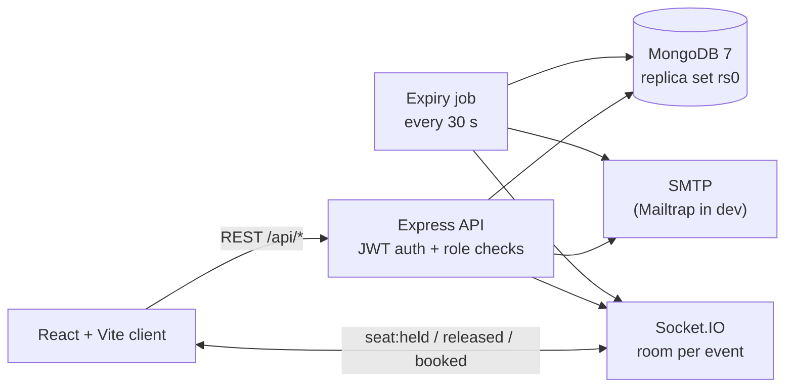
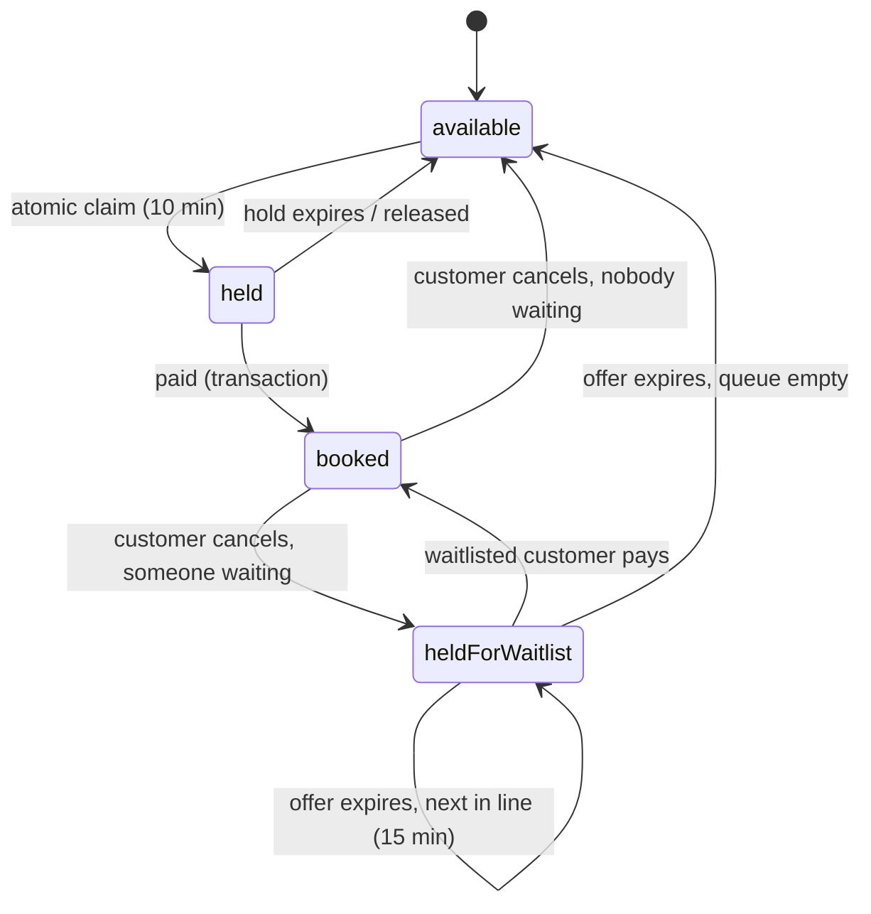

# TicketX — Movie & Concert Booking Without Double-Booking

TicketX is a full-stack ticket booking platform for movies and concerts. It is built for the moment tickets go on sale: many customers click the same seat at the same time, and **a seat can never be sold twice**. That guarantee is enforced by atomic MongoDB operations and transactions, and proven by an automated test that fires 50 simultaneous requests at one seat, 20 times in a row.

**Stack:** React 18 · Vite · Tailwind · Node.js 20 · Express · MongoDB 7 (replica set) · Mongoose · Socket.IO · JWT · Nodemailer · qrcode · Jest · Docker

---

## Features

| Area | What it does |
| --- | --- |
| Accounts | Register / log in with JWT. Three roles: **customer**, **organiser**, **admin**, checked on every request. Admins can block accounts. |
| Seat map | Live seat map per event. Seats change colour for everyone instantly via Socket.IO (available / held by me / held by others / booked). |
| Seat holds | Clicking a seat holds it for **10 minutes** using one atomic database update. Max 6 seats per customer per event. |
| Checkout | Mock payment confirms all held seats in a single **MongoDB transaction**: all seats are booked or none are. |
| Expiry job | Every **30 seconds**, abandoned holds are released (or offered to the waitlist) and every open seat map updates. |
| Waitlist | When an event is sold out, customers join a **FIFO waitlist**. A cancelled seat is held for the next person for **15 minutes** and they're emailed. If they don't book, it moves to the next person. |
| Tickets | Each booking gets a **QR code** (random 128-bit token), shown in *My Tickets* and emailed. |
| Gate check-in | Organisers verify QR codes at the entrance. Each ticket is admitted **exactly once**, even if scanned at two gates at the same moment. |
| Dashboards | Organisers see sold / held / revenue / occupancy / waitlist / check-ins per event and every booking. Admins see platform revenue, top events and user management. |

---

## Architecture



Seat lifecycle:



---

## How double-booking is prevented

### 1. Holding a seat is one atomic operation

```js
const seat = await Seat.findOneAndUpdate(
  {
    _id: seatId,
    eventId,
    $or: [{ status: 'available' }, { status: 'held', holdUntil: { $lt: now } }],
  },
  { $set: { status: 'held', heldBy: userId, holdUntil: now + 10 minutes } },
  { new: true }
);
if (!seat) return res.status(409).json({ error: 'Seat just taken' });
```

The availability check and the write happen in **one** database step. MongoDB applies writes to a single document one at a time, so when 50 requests arrive together, the first one changes the status to `held` and the other 49 no longer match the filter. There is never a "read the seat, then write it" gap for two users to slip through.

### 2. Paying is all-or-nothing

Confirming a multi-seat booking runs inside a MongoDB transaction. Each seat must still be `held` by this user with an unexpired hold. If any one seat fails, the transaction is aborted and **no** seat is booked.

### 3. Cancellations and the waitlist are race-safe too

Handing a freed seat to the waitlist (`server/src/services/waitlistService.js`) works in three conditional steps:

1. **Lock the seat** with an atomic update that only matches if the seat is still in the expected state (e.g. "booked under the cancelled booking"). If anything changed it in the meantime, we back off.
2. **Claim the earliest waiting customer** with one `findOneAndUpdate` sorted by join time (FIFO).
3. **Give them the locked seat** for 15 minutes, or put it back on sale if nobody is waiting.

Locking the seat *before* touching the queue matters: if two expiry-job runs overlap, only the one that wins the seat takes someone from the queue, so the earliest person always gets it. A test runs three jobs at once to check this.

If the server crashes after a booking is cancelled but before its seats are released, the expiry job finds it and finishes the release.

### 4. Each ticket is admitted once

Gate check-in is a single update conditioned on `checkedInAt: null`. Ten simultaneous scans of the same QR code produce one "admit" and nine "already used".

---

## Running it

### Option A: Docker (one command)

```bash
docker compose up --build
```

- Client: http://localhost:5173
- API: http://localhost:5000/api/health
- MongoDB runs as replica set `rs0`. Demo data is seeded automatically on first start.

### Option B: Local development

You need Node.js 20+ and MongoDB running as a replica set (the easiest way is `docker compose up mongo`).

```bash
cp .env.example server/.env

cd server
npm install
npm run seed      # demo users, 4 events
npm run dev       # http://localhost:5000

cd ../client
npm install
npm run dev       # http://localhost:5173
```

### Email (optional)

Without SMTP credentials, emails are skipped and logged. To see real emails, create a free [Mailtrap](https://mailtrap.io) inbox and set `SMTP_USER` / `SMTP_PASS` in `server/.env` (or export them before `docker compose up`).

---

## Demo accounts

Password for all: `Password123!`

| Role | Email |
| --- | --- |
| Admin | `admin@ticketx.com` |
| Organiser (movies) | `cinema@ticketx.com` |
| Organiser (concerts) | `concerts@ticketx.com` |
| Customers | `alice@` `bob@` `charlie@` `diana@` `evan@ticketx.com` |

Seeded events: three large events (200+ seats each) and **"Sold-Out Jazz Night (Waitlist Demo)"**, a 12-seat show fully booked by Bob (row A) and Charlie (row B).

### 5-minute demo

1. **Live seat race:** open any big event in two browser windows logged in as Alice and Diana. Click the same seat. One gets it; the other sees "Seat just taken", and both maps update instantly.
2. **Checkout:** as Alice, hold a few seats and watch the 10-minute countdown. Click *Pay & Confirm*. The QR ticket appears and is in **My Tickets**.
3. **Waitlist:** as Alice, open *Sold-Out Jazz Night* and click **Join waitlist** (you're #1). As Diana, join too (#2).
4. **Cancel:** log in as Bob → My Tickets → cancel the Jazz Night booking (6 seats). In FIFO order, Alice is offered the first freed seat and Diana the second, each held for 15 minutes; the other 4 seats go back on sale. Alice's event page shows a green banner with the seat in her checkout. Click *Pay & Confirm*.
5. **Gate check-in:** as Alice, copy the ticket code under the Jazz Night QR in My Tickets. Log in as `concerts@ticketx.com` → Organiser Portal → *Check in a ticket* → paste → **Admit**. Paste again → **Already used**.
6. **Dashboards:** the organiser portal shows sold/held/revenue/waitlist per event; the admin panel shows platform revenue and top events.

---

## API

| Method | Path | Who | Purpose |
| --- | --- | --- | --- |
| POST | `/api/auth/register` | public | Create customer / organiser account |
| POST | `/api/auth/login` | public | Get a JWT |
| GET | `/api/auth/me` | any | Current user |
| GET | `/api/events` | public | List events (`type`, `city`, `search` filters) |
| GET | `/api/events/:id` · `/api/events/:id/seats` | public | Event details · seat map |
| POST | `/api/events` | organiser, admin | Create event (seats generated from venue layout) |
| GET / POST | `/api/venues` | public / organiser | List / create venues |
| POST | `/api/seats/:id/hold` · `/release` | customer | Hold (10 min) / release a seat |
| POST | `/api/bookings/confirm` | customer | Pay for held seats (transaction) |
| GET | `/api/bookings/my` · `/api/bookings/:id` | owner | Tickets with QR codes |
| POST | `/api/bookings/:id/cancel` | owner | Cancel; seats go to waitlist |
| GET | `/api/waitlist/my` | customer | My queue positions and offers |
| POST / DELETE | `/api/waitlist/:eventId/join` · `/api/waitlist/:eventId` | customer | Join (only when sold out) / leave |
| POST | `/api/tickets/verify` | organiser (own events), admin | Check a QR code in, once |
| GET | `/api/organiser/events` · `/events/:id/bookings` | organiser, admin | Sales stats · bookings |
| GET / PATCH | `/api/admin/stats` · `/api/admin/users` · `/users/:id/block` | admin | Platform stats · user management |

Errors are always JSON: `{ "error": "message" }`.

---

## Tests

```bash
cd server
npm test
```

Jest + Supertest run against an in-memory MongoDB **replica set** (`mongodb-memory-server`), so transactions behave exactly as in production.

| File | Covers |
| --- | --- |
| `race.test.js` | **50 users hold the same seat at once, 20 rounds:** exactly 1× `200`, 49× `409`, one holder in the database every round |
| `eventsAndSeats.test.js` | Seat generation, hold/release, multi-seat transaction rollback, expiry job |
| `waitlistAndTickets.test.js` | QR tickets, one-time check-in (incl. 10 simultaneous scans), cancellation (incl. 10 simultaneous cancels), FIFO waitlist, offer expiry hand-off, leaving with an offer, 3 overlapping expiry jobs |
| `auth.test.js` | Registration, validation, login, blocked users, role checks |
| `seed.test.js` | Seed data, including the sold-out demo event |

---

## Security notes

- Passwords hashed with bcrypt; JWT secret required in production.
- Role checks on every protected route; organisers only see and verify their own events.
- Rate limits on login, registration, seat holds and bookings.
- Search input is escaped before being used in a regex.
- QR codes contain only a random token, never personal data. The token is never returned in booking lists, only to the ticket's owner.
- User-provided text is HTML-escaped in emails.

---

## Project structure

```
ticketx1/
├── client/                 React + Vite
│   └── src/
│       ├── api/            axios calls (events, tickets, auth)
│       ├── components/     Navbar, ProtectedRoute, TicketVerifier
│       ├── context/        AuthContext
│       └── pages/          Events, EventDetails (seat map + checkout + waitlist),
│                           MyTickets, OrganiserDashboard, AdminDashboard
├── server/
│   ├── src/
│   │   ├── controllers/    auth, events, seats, bookings, venues
│   │   ├── jobs/           seatExpiryJob (30 s)
│   │   ├── middleware/     auth + requireRole, validation, errors
│   │   ├── models/         User, Venue, Event, Seat, Booking, WaitlistEntry
│   │   ├── routes/         auth, events, seats, bookings, waitlist, tickets, organiser, admin
│   │   ├── services/       waitlist, email, qr, seat generation
│   │   └── sockets/        seat rooms per event
│   └── tests/
└── docker-compose.yml      mongo (rs0) + server + client
```
