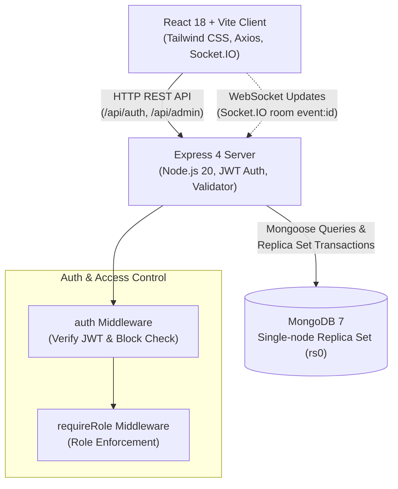

# TicketX — High-Concurrency Ticket Booking Platform

TicketX is a high-concurrency movie and concert ticket booking platform engineered to handle flash-sale ticketing drops where thousands of users contend for identical seats simultaneously.

The core guarantee of TicketX: **a seat can NEVER be sold twice**, enforced by atomic database operations and MongoDB multi-document transactions.

---

## 🏛️ Phase 1 Architecture & Specifications

### Tech Stack
- **Frontend**: React 18, Vite, React Router, Tailwind CSS, socket.io-client, axios, Lucide React
- **Backend**: Node.js, Express, Mongoose, Socket.IO, jsonwebtoken, bcrypt, express-validator, express-rate-limit, nodemailer, qrcode
- **Database**: MongoDB 7 running as a single-node **Replica Set** (`rs0`) for ACID transaction support
- **Testing**: Jest + Supertest + `mongodb-memory-server` (`MongoMemoryReplSet`)
- **Containers**: Docker + Docker Compose (`mongo`, `server`, `client`)

### Role-Based Access Control (RBAC)
Role definitions stored inside JWT claims and verified by `auth` and `requireRole(...roles)` middlewares:
- **`customer`**: Browse events, reserve seats via atomic holds, confirm bookings, cancel tickets, and join waitlists.
- **`organiser`**: Create venues & seating blueprints, schedule events, monitor ticket sales, verify QR codes.
- **`admin`**: System oversight, view platform analytics, inspect user accounts, toggle account ban/block statuses.

---

## 🔐 Concurrency & Seat Locking Rules

1. **HOLD (Atomic)**:
   A single-step `Seat.findOneAndUpdate` whose filter condition guards against stale states:
   ```javascript
   filter: {
     _id: seatId,
     eventId: eventId,
     $or: [
       { status: 'available' },
       { status: 'held', holdUntil: { $lt: new Date() } }
     ]
   }
   update: {
     status: 'held',
     heldBy: userId,
     holdUntil: new Date(Date.now() + 10 * 60 * 1000) // 10 minutes
   }
   ```
   *If no document matches, returns HTTP 409 "Seat just taken". Two-step read-then-write is strictly forbidden.*

2. **CONFIRM (ACID Transaction)**:
   Executed inside a MongoDB transaction for multi-seat bookings. Atomically changes status to `'booked'` if held by the requesting user and hold has not expired (`holdUntil > now`). If any seat in the selection fails, the entire transaction is aborted.

3. **RELEASE**:
   Holders can release seats early, resetting status to `'available'`.

4. **EXPIRY SWEEPER**:
   Periodic job sweeps expired holds back to `'available'` and emits Socket.IO change notifications.

---

## 🏗️ Architecture Diagram



---

## 🚀 Running the Project

### Prerequisites
- Node.js (v20+ recommended)
- Docker & Docker Compose (for containerized deployment)

### 1. Environment Configuration
Copy the example environment file:
```bash
cp .env.example .env
cp .env.example server/.env
```

### 2. Local Development Setup

#### Backend (Server)
```bash
cd server
npm install
npm test            # Runs Jest suite using in-memory ReplicaSet
npm run seed        # Seeds 1 Admin, 2 Organisers, 5 Customers
npm run dev         # Starts server on http://localhost:5000
```

#### Frontend (Client)
```bash
cd client
npm install
npm run dev         # Starts Vite dev server on http://localhost:5173
```

### 3. Docker Compose (Full Stack with Replica Set)
Run all services with a single command:
```bash
docker compose up --build
```
This boots:
- `ticketx-mongo`: MongoDB 7 configured as a single-node replica set `rs0` on port 27017
- `ticketx-server`: Express backend on port 5000
- `ticketx-client`: Vite React application on port 5173

---

## 👥 Seed Credentials (from `npm run seed`)

All demo accounts share the password: `Password123!`

| Role | Name | Email | Password |
|---|---|---|---|
| **Admin** | TicketX Administrator | `admin@ticketx.com` | `Password123!` |
| **Organiser** | Cinema World Studios | `cinema@ticketx.com` | `Password123!` |
| **Organiser** | Live Beats Concerts | `concerts@ticketx.com` | `Password123!` |
| **Customer** | Alice Johnson | `alice@ticketx.com` | `Password123!` |
| **Customer** | Bob Smith | `bob@ticketx.com` | `Password123!` |
| **Customer** | Charlie Davis | `charlie@ticketx.com` | `Password123!` |
| **Customer** | Diana Prince | `diana@ticketx.com` | `Password123!` |
| **Customer** | Evan Wright | `evan@ticketx.com` | `Password123!` |

---

## 🧪 Testing

Phase 1 includes an automated test suite verifying:
- Customer and organiser registration
- Input validation (valid email, min 6 char password)
- Duplicate email prevention (409 Conflict)
- User authentication and password hash verification
- Blocked user access prevention (403 Forbidden)
- Role-based authorization (`requireRole`)
- Admin listing users and blocking/unblocking accounts

To run the automated test suite:
```bash
cd server
npm test
```
